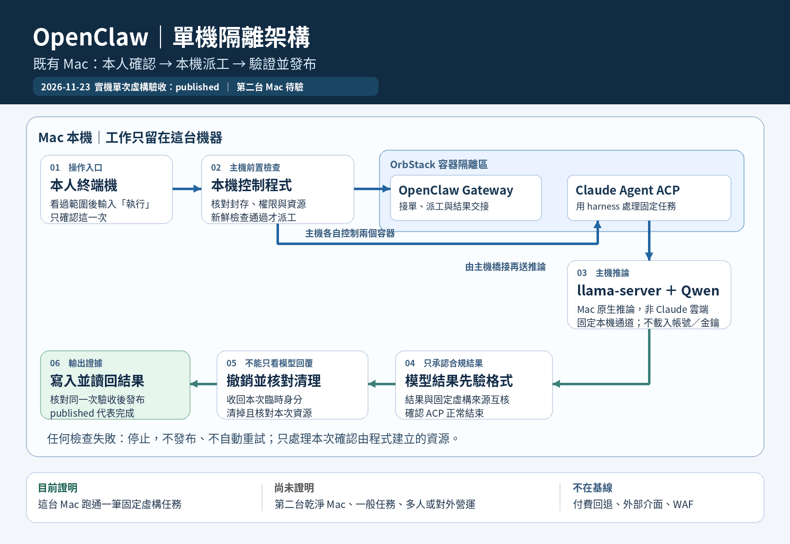

# OpenClaw 本機派工實驗

給想在 Apple Silicon Mac 上用 OpenClaw 派工、讓 Qwen 在本機推論的人參考。

狀態：原機已通過單次隔離驗收；第二台 Mac 尚未驗證。

## 預覽圖



OpenClaw 負責派工，Claude Agent ACP 提供代理工作流程，Qwen 負責推論。這次試行沒有把模型請求交給付費雲端模型。

## 功能

- **本機派工：** 在一台已備妥的 Mac 上，完成一筆只使用虛構資料的固定任務。
- **隔離執行：** 每次由操作者在終端機確認；工作在兩個隔離容器和 Mac 原生推論程序中完成。
- **驗證成果：** 程式核對本次回傳、撤銷臨時身分、確認清理及讀回成果後，才回報 `published`。

[查看 Phase 1 實測結果](docs/phase1-results.md)。尚未驗證第二台乾淨 Mac、真實資料、常駐服務、多人使用或對外介面。

## 使用技術

| 元件 | 用途 |
| --- | --- |
| OpenClaw Gateway | 接收並派發固定任務 |
| Claude Agent ACP（ACP v1） | 執行代理工作流程，不是這次試行的推論模型 |
| OrbStack | 在 Mac 上執行兩個隔離容器 |
| llama.cpp 和 Qwen3.6 | 在 Mac 上原生推論 |

## 安裝與執行

這個 repo 提供驗收資料、建置流程及可執行的唯讀預檢。**尚未提供可直接安裝的新機套件。**

```sh
bash scripts/preflight.sh
```

[腳本使用說明與驗收限制](docs/scripts.md)。`run-smoke-test.sh` 是驗收入口，目前欠缺經核准的新機套件，會回報阻擋，不會啟動或假報通過。

要在自己的 Mac 上評估：

1. 從[環境盤點與建置流程](docs/macos-runbook.md)開始，確認 Apple Silicon、記憶體、磁碟和本機引擎。實測版本與限制也記在這份文件。
2. 規劃目標機專用的設定與封存；不要複製原機的帳冊、憑證或啟動指令。
3. 等新機版本備妥並完成唯讀預檢後，再由本人於終端機啟動一次虛構驗收。

## 資料夾結構

- [`docs/phase1-results.md`](docs/phase1-results.md)：原機實測、證據與已知限制。
- [`docs/macos-runbook.md`](docs/macos-runbook.md)：環境盤點、建置、驗收、回復與可交給 AI 的提示詞。
- [`docs/architecture.png`](docs/architecture.png)：本機派工與驗收流程圖。
- [`scripts/`](scripts)：預檢和驗收入口。
- [`tests/`](tests)：離線測試。

## 授權

本 repo 附有 [MIT License](LICENSE)。第三方元件各自適用其授權；原機實測組合不等於完整開源、商業零成本或原廠支援的方案。
