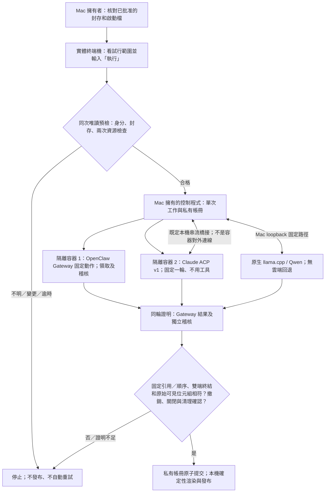

# OpenClaw 本機建置與跨 Mac 驗收

**Phase 2 執行草案 v0.1 · 2026-11-23**

這台 Mac 已由本人完成一次固定虛構任務，終端機回報 `published`。這份文件把已實測流程轉成第二台 Mac 的安裝、設定、啟用及驗收順序。**新機專用封存與乾淨機驗收尚未完成，不能直接複製舊機啟動指令。**

請搭配[架構圖](architecture.png)與[Phase 1 結果報告](phase1-results.md)。最重要的停止條件：沒有新機證據，就先報缺什麼；不要猜、代輸入確認、自己改安全設定或重跑。

## 最短路徑

| 順序 | 做什麼 | 下一步的條件 |
|---|---|---|
| 1 | 唯讀清點目標 Mac，填下方環境表 | 相容架構、容量、版本和資源都查得清楚 |
| 2 | 準備並查驗固定元件與模型 | 有來源和可核對的不可變指紋，不用 `latest` 替代 |
| 3 | 建立這台機器的配置與新版封存 | 初次／既有安裝分支分清楚，無不明資源 |
| 4 | 核准後安裝、放置並逐檔獨立讀回 | 不覆蓋舊版、版本和權限都吻合 |
| 5 | 這台 Mac 的本人終端機執行一筆虛構驗收 | `published`、結果讀回、安全結案；其他狀態都不當成功 |

**目前可直接做第 1 步；第 2～4 步要有核准的來源清單、可取得的固定工件，以及新機專用安裝程式。** 本文件不含可直接重播的舊機授權、下載腳本、憑證或資料。原機版的四筆舊帳冊是實際歷史，不是「必須先做四次測試」的通用條件。

## 一次把環境資料填齊

可在目標 Mac 的終端機逐行唯讀執行，這些指令不安裝軟體：

```sh
sw_vers
uname -m
sysctl -n hw.memsize
df -h "$HOME"
id -u
```

記在目標電腦，不把 UID、私人路徑或原始系統輸出貼到公開頻道。之後經核准的核對器只查本次指定範圍，不掃描整台電腦。建議記錄：

| 項目 | 目標機填寫／驗證方式 |
|---|---|
| 設備 | 晶片、macOS 版本與 build、總記憶體、當下壓力、可用磁碟、操作者與前景終端機 |
| 主機工具 | Python 與 Node 精確版本、正規絕對路徑及執行檔 SHA-256；比對簽章或可追溯來源 |
| 容器 | 指定 OrbStack 本機 Docker 引擎及持有者、固定 Linux ARM64 映像的 SHA-256，確認是否共用 |
| 模型 | 原生 llama-server 版本、二進位檔 SHA-256 和簽章；模板 SHA-256；選定 Qwen GGUF 的完整 SHA-256 與來源 |
| 配置 | 新的安裝／狀態／輸出目錄、專用本機埠、固定容器角色；初次安裝／既有安裝／無法確認 |
| 驗收 | 兩次同輪資源核對、正常終止、撤銷、清理與結果讀回；個別記錄而不是只寫「有回應」 |

| 元件 | 這台 Mac 的實驗基線（不是跨機最低需求） |
|---|---|
| OpenClaw | v2026.11.5；ARM64 本機映像有固定雜湊。套件清冊列 ACPX 0.21.0，不代表 stock ACPX 是這次通過的路徑 |
| Agent | Claude Agent ACP 0.95.0、Claude Agent SDK 0.3.309；以 ACP **v1** 串接。使用 harness，不把本機 Qwen 當 Claude 服務 |
| 主機執行環境 | Python 3.13.18、Node 26.13.1：原機核對過絕對路徑與執行檔雜湊；新機重新核對 |
| 推論 | llama.cpp b12177（`6c01da627`）；Qwen3.6 35B-A3B Q4_K_M 約 24 GB。當次查了尺寸與 GGUF v3 標頭，**不等於重算整顆模型 SHA** |
| 資源／埠 | 原候選曾以引擎回報至少 6 GiB、主機可用比例 ≥35% 為環境核對值，不是整機規格。18960、19234、19235 為原機範例；不搶占，不能無審查改用其他埠 |

## 1. 確認設備與備妥材料（唯讀）

- 先確認第二台是 Apple Silicon，記下 macOS 版本、晶片、記憶體、剩餘磁碟、使用者 UID 與安裝位置。原 Mac 當次資源檢查已通過；未驗證 Intel、不同版本的 macOS 或較低容量。不要把 VM 的最低記憶體門檻當成 Qwen 的整機需求。
- 準備一份「版本／來源／雜湊」清單：Python、Node、OrbStack 與指定 Docker CLI、固定 arm64 容器映像、OpenClaw／Claude ACP 組件、原生 llama.cpp runner、Qwen GGUF 與對應對話模板、套件清單及本人啟動檔。先核對既有安裝，不自動升級。Brewfile 只能列依賴，不保證版本或執行檔位元組一致。
- 原 Mac 的已核對基線包括 Python 3.13.18、Node 26.13.1、OrbStack 及本機 Qwen runner；細節以完整發行清單為準，不拿模型名稱、映像 tag 或使用中 Ollama 的同名版本當成相同檔案。缺少可信版本來源、完整雜湊或資源容量，就停在本步。原生 runner 不是現有 Ollama；不用為了這次驗收改 Ollama 或加裝一套預設會自啟的服務。

## 2. 為新機建立獨立設定（只能先出計畫）

- 原 Mac 的 v2 驗收把帳號、絕對路徑、引擎／socket 身分及四組舊工作狀態固定在該台主機。**這是目前跨機前最重要的缺口。** 不能把原指令、帳冊、引擎身分、配對憑證、測試 token、暫存、結果或安裝路徑整包搬過來。
- 先提出這台機器專用的設定與新封存：固定本機帳號／路徑、容器映像雜湊、受信任的 socket 持有者與引擎、配置檔、獨用工作命名與輸出位置。候選的安裝與啟動邏輯須獨立查核；不得用改 UID、移除現有檔案、放大 Docker 權限、繞過簽章檢查等辦法讓舊版勉強通過。
- 乾淨新機另需「初次安裝」驗證分支：用新機的受信任來源證實沒有本流程的舊工作或保留資源；發現同名／可疑殘留或無法查證就拒絕。不可假造四本舊帳冊，也不可把缺少舊帳冊一律解讀成安全。既有使用者或共用引擎要走明確舊工作查核，保留同一引擎的兩次新鮮核對與就緒期限。新機分支目前尚未實作和實測。
- 區分兩個階段：安裝依賴若缺檔可能需官方下載，先列品項、來源及實際變動請本人核准；實機驗收則只用固定本機材料。沒有外部 AI 雲端帳號、API 金鑰或登入資料是驗收前提。模型來源、桌面端或系統的所有背景網路行為限制要依實際可觀察範圍，不用「未發現」宣稱完全沒嘗試外連。

## 3. 安裝與放置（本人核准後，還不啟動）

1. 只補已列出且已核准的缺項，記錄實際來源、版本、雜湊、路徑及是否同時影響其他軟體。遇到權限提示、額外依賴、升級、付費或落在系統設定的變更先停止，明確說明，不自行點允許。
2. 將新機密封套件放進一個新、明確的資料夾。原版是 48 件內容加獨立封存清單、另附一個不可直接執行的本人啟動檔；移植版以自己經審查的清單為準。不能覆蓋、替換或順便清掉既有目錄。放置後分開重新讀取實體檔案，確認檔案清單、雜湊、權限、擁有者、唯一受控配置與啟動檔均吻合。即使安裝程式說失敗，也先查這批核准範圍內的實物，不按第二次安裝。
3. 跑經核准的唯讀前置核對：指定引擎與固定映像、記憶體及磁碟、固定路徑與埠、同名容器（包含停止的）、受管程序及暫存。唯讀核對通過不代表已做工作，也不能被下一次啟動直接拿來當通行證。留存只有摘要，不保存路徑以外不必要的識別碼、原始日誌、模型輸入或憑證。

## 4. 本人前景啟動與判定

1. 新機真正要驗收時，只給本人一條**已再次核對、針對新機封存**的專用啟動指令。由本人在該台 Mac 終端機打開，先看到範圍與停止規則，確認後自己輸入「執行」。不接受在背景代輸入；未同意、取消、逾時、封存或資源變了都不啟動。
2. 每份授權只跑一筆固定虛構資料：隔離的 OpenClaw 與 ACP 容器、指定本機 Qwen、一張固定核對卡。工作上限 240 秒含清理；前置核對另算。預計結果目錄在同層獨立位置，由啟動器先明示，不能碰真實專案。
3. **通過**：本人這次的終端機出現 `published`，並能對照同次新建核對卡位置、預期雜湊及安全結案摘要。程式必須完成同一筆模型與 ACP 結果對照、撤銷與清理、提交與讀回才可回報成功。**不通過**：只有前置核對成功、`verified_save_unconfirmed`、拒絕、逾時、卡片找不到或清理未確定，都不要標為完成，也不要自行重跑。

## 5. 停止與回復

- 未輸入「執行」：停止，最多留下這次新增的密封套件與啟動檔。先記下發生到哪；若要移除，只處理已同意移除的新物件，不碰其他版本與共享資源。
- 已啟動：由程式原有的精確歸屬範圍清理。本次狀態即使沒有卡也保留；不可刪掉鎖、改目錄或換一個參數重來。若清理不確定，先把安全摘要交給維護者，另行批准後只檢查這一筆已知資源；不要停止共享 OrbStack／Ollama、不做 Docker prune、不強制移除不確定的服務。
- 未經批准不移除或降版共用依賴。若須回復，列出此次增加或修改的檔案／版本、預期影響、可確認的原狀和復原方法，經本人核准後才操作。

## 交付與驗收記錄模板

`主機／macOS｜封存與依賴版本｜唯讀核對結果｜本人確認時間｜終端機狀態｜卡片位置與雜湊｜清理證據｜是否允許重跑（本例否）`

第二台 Mac 只有在上表獨立完成一筆驗收後才能標「跨機通過」。未取得設備、移植版封存、核准或正面結果，都以「尚未驗證」回報。

## 可以直接交給 AI 維護助理的提示詞

> 你負責按這份 SOP，把 OpenClaw 的單次虛構核對卡驗收移植到指定的第二台 Apple Silicon Mac。原 Mac 一次成功不等於新機成功；不得複製原 Mac 的帳冊、憑證、引擎識別或結果。第一步只做當前已允許的唯讀清點，列出 macOS／設備、既有版本、官方來源與雜湊、磁碟／記憶體、固定埠及會受影響的設定。區分「已核對、缺項、無法確認」，對不齊先說具體阻礙，不安裝、不拉最新映像、不跳過完整性或權限檢查。
>
> 再提出下台主機可獨立核對的固定設定、初次安裝資源查核、新封存與獨立輸出路徑。先向本人確認精確安裝與放置範圍；獲准後只放置，不啟動，並用另一段唯讀檢查核對實體檔。實機啟動須另有該次明確批准，並由本人在正確終端機輸入「執行」。只用一筆固定虛構資料、固定本機模型和隔離容器，不讀寫真實專案。任何拒絕、變動、部分結果或清理未知都停止、保留紀錄、不重跑，不簡化成成功。
>
> 最後交付一份清單：已完成、未完成、需要本人決定的**具體**下一步，以及版本雜湊／唯讀核對、本人終端機結果與卡片位置（有才填）。不要輸出 raw prompt、憑證、原始日誌、完整程序／容器識別或未核准的真實檔案內容。

## 公司導入與版本參照

- 這套通過驗收的組合**不是全開源或保證零成本**。OrbStack 對商業用途採按使用者授權，裝到公司設備前先核對適用方案；Claude Agent SDK 的授權條款也要先確認。Anthropic 不支援經其 gateway 設定使用非 Claude 模型，本地 Qwen 路線在本次是自有整合驗收，不是原廠支援承諾。[OrbStack 授權](https://docs.orbstack.dev/licensing) · [Claude Agent SDK 條款](https://code.claude.com/docs/en/agent-sdk/overview#license-and-terms) · [Claude LLM gateway 支援範圍](https://code.claude.com/docs/en/llm-gateway)
- 已固定的版本參照：[OpenClaw v2026.11.5](https://github.com/openclaw/openclaw/releases/tag/v2026.11.5) · [Claude ACP v0.95.0](https://github.com/agentclientprotocol/claude-agent-acp/releases/tag/v0.95.0) · [Claude ACP 依賴清單](https://raw.githubusercontent.com/agentclientprotocol/claude-agent-acp/v0.95.0/package.json) · [llama.cpp b12177](https://github.com/ggml-org/llama.cpp/releases/tag/b12177)。ACP 清單宣告 Node ≥22、SDK 0.3.309，這不是本次 Mac 主機核對過的 Node 26.13.1 的替換條件。發行頁也不代替檔案／映像雜湊。
- [Colima](https://github.com/abiosoft/colima)／[OpenCode](https://opencode.ai/docs/) 可以另立候選比較；它們沒有通過這套流程的同等實機驗收，不是目前的自動備援。
- 技術驗證等級：原 Mac 的 Python／Node 採絕對路徑與檔案雜湊核對；原生 runner 記錄 revision `6c01da627`，核對二進位 SHA 和簽章。當次 GGUF 只核對固定大小及 8 位元組標頭，未重算模型全檔 SHA；新機取得模型前要有可驗證完整來源與全檔雜湊。ACPX 0.21.0 為釘選的版本資料；ACP v1 連線與結束流程已通過此機驗收，但沒有把版本資料當作對新映像探測的結果。原 Mac 的 exact macOS／OrbStack 發行版目前沒有可靠紀錄，需補實機欄位或註明未知。
---
# 附錄：架構、實測記錄與可重現性

## 可引用的基準

2026-11-23，使用者在原 Mac 的終端機對封存的虛構核對卡執行一次，回傳畫面顯示 `published`。這是**同一台 Mac、現成且固定版本環境、一次受限合成流程**的本人操作證據。發布是程式在同輪核對、撤銷、清理與帳冊提交後才允許的狀態，不是雲端回覆、接受請求或僅啟動成功。畫面本身未顯示結果內容、逐項耗時或新的獨立事後清冊；手冊不要把讀回封存和最終畫面視為逐項事後驗證。此處「核對卡第二版」是本專案版本；ACP 傳輸仍用 v1，不是 ACP v2 或 OpenClaw 原生 ACPX 的驗收。

## 架構／操作流程（Mermaid 原始碼）



兩個容器各自隔離，無公開埠、共享引擎 socket 或一般網路路由；主持程式負責固定介面與本機橋接。Qwen 執行在 Mac，不在容器中。Gateway 接受請求不等於工作完成。資料設計將來源已知事實留在擁有者端，模型只選擇允許的引用與順序；以另一份規則核對，不把錯誤模型值靜默改成正確。通過後才由本機模板渲染。單純串流 EOF 不等於正常終止、內容正確、程序已回收或暫時權限已撤銷；清理不能確認也不發布。

## 可重現性驗證矩陣

| 證據／目標 | 已觀察或應驗證 | 不可外推 |
|---|---|---|
| Linux 離線協定／管線 | 用受控資料、固定子程序或 fixture 驗證 framing、EOF、等待／逾時回收、拒絕與證據比對單元。 | 非真 Gateway／ACP 或 Qwen 端到端；不是 Linux 安裝、GPU 或生產相容性。 |
| 同一 Mac 00:57 UTC（08:57 台北） | 前一輪 -14 單一舊工作範圍的當下唯讀資源核對；不啟動工作。 | 只證那時的觀測、不證四組範圍或後來也空閒；不把舊帳冊視為已修復。 |
| 同一 Mac 01:33 UTC（09:33 台北） | 一次真機唯讀預演：兩個小型管線 fixture，正常 EOF／回收及逾時分離；兩次各查四組舊範圍的資源檢查，單次各低於 20 秒，總核對在 115 秒上限內。只回傳 `preflight_verified`、`workload_started:false`。 | 沒有逐項秒數、不發任何可重用票據，不等於 Qwen 推論、安裝或正式部署。 |
| 同一 Mac 約 02:09 UTC（10:09 台北） | 獨立實體讀回 48 個資產、封存和隨附啟動檔皆符合，`workload_started:false`。 | 驗證檔案與權限模式，不是執行、付款、另一台裝置或同日資源可用性。 |
| 同一 Mac 約 02:12 UTC（10:12 台北） | 使用者本人前景試行截圖為一次 `published`；固定虛構輸入、本機 Qwen、同輪驗證後可發布。 | 未驗跨 Mac、任意輸入、一般工具、常駐服務、取消／續接或外部流量；截圖未包含逐項事後稽核。 |
| 另一台已備妥的 Mac（Phase 2 尚待） | 新查 OS 版本／build／架構；固定版本、簽章或雜湊、動態連結、自有容器引擎／映像架構、模型及模板、資源與本機端點；做新的唯讀預檢與一筆固定合成驗收，核對相同證明和撤銷／清理。註明沿用快取與模型。 | 「已備妥機器重放」不是乾淨安裝。不能用已跑證據取代現況核對或沿用舊授權。 |
| 乾淨 macOS 或 Linux 安裝（Phase 2 尚待） | 分開列硬體／VM、作業系統、架構和實際加速方式。記錄從何取得固定工件、原生相依能否啟動、無外連固定任務與乾淨終止，未驗的列未驗。 | VM 啟動不等於 Apple Silicon／Metal 真機；Linux 的 CPU／GPU 成功也不是 macOS 保證。 |

## 手冊應固定哪些東西

- **基礎版本／來源：** OpenClaw v2026.11.5、Claude Agent ACP v0.95.0／ACP v1、實際映像的平台及不可變摘要、Python／Node／原生函式庫、實際 llama.cpp 版本與模板、模型檔完整性來源及授權。Homebrew 清單作為清冊，不當作鎖版；記錄實際路徑、已安裝版本與復現可取得的產物，不承諾 `brew bundle` 會重現原機。測試時的新 OS／當下可用記憶體應由目標端讀回；不要引用老系統版本為相容性結論。
- **三條驗證分開記錄：** 啟動前同次唯讀檢查；固定主任務的兩端正常停止及同輪證明；明確撤銷、同一臨時身分再登入遭拒、精確程序／容器／暫存清理與本機提交。保留最小去識別化狀態，不把原文、憑證、路徑、工作資料或推理內容複製到公開手冊。
- **Phase 3 選配，非必要：** 基礎流程無雲端路由。Octopus 或 LiteLLM 只有真的需要受控多模型路由、成本或外部模型策略時，才選一層另驗；WAF 只有新增有權外部 HTTP 入口才有必要評估。不可把 WAF 當主機隔離、權限或資料治理，也不應先為本機指南開對外端口。這些元件、雲端費用、公開入口及跨機工作流均未含在本次驗收。
- 不將單次封存搬成長期授權，不從包內重新提交舊工作，不附現成啟用指令。手冊第一頁優先圖示化「核對 → 本人允許 → 看結果 → 失敗停止」，工程附錄才列計時、連結與工件版本。

官方依據：[OpenClaw Docker 指南](https://docs.openclaw.ai/install/docker)；[Claude ACP v0.95.0 版本](https://github.com/agentclientprotocol/claude-agent-acp/releases/tag/v0.95.0)；[ACP v1 prompt turn](https://agentclientprotocol.com/protocol/v1/prompt-turn)；[Docker none 網路](https://docs.docker.com/engine/network/drivers/none/)。官方文件支持各介面定義，不代表本專案已驗證其他部署路徑。

